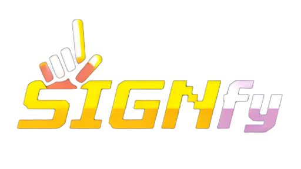
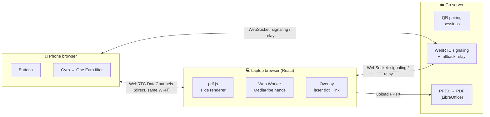
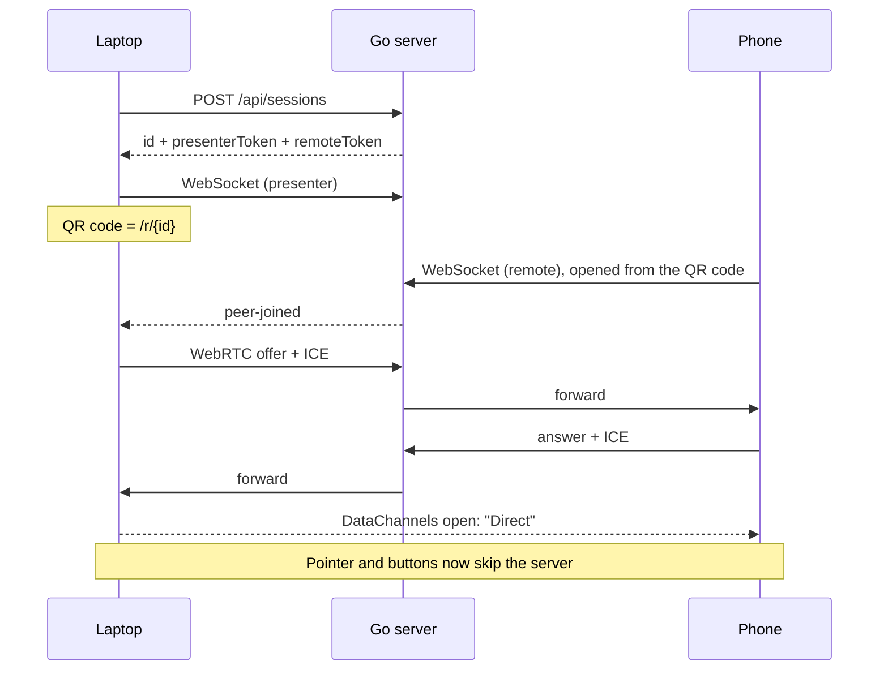

<div align="center">



### Control your presentations with hand gestures, or turn your phone into a clicker and laser pointer.

[](https://go.dev)
[](https://react.dev)
[](https://www.typescriptlang.org)
[](https://vite.dev)
[](https://webrtc.org)
[](https://ai.google.dev/edge/mediapipe/solutions/vision/hand_landmarker)

[**Quick start**](#-quick-start) · [**Deploy**](#-deployment) · [**How it works**](#-how-it-works) · [**Demo (v1)**](https://youtu.be/TeOxVTLrOes)

[](https://render.com/deploy?repo=https://github.com/Pranav-Conova/Signify)

</div>

---

## Table of contents

- [Overview](#-overview)
- [Features](#-features)
- [How it works](#-how-it-works)
- [Latency by design](#-latency-by-design)
- [Controls](#-controls)
- [Quick start](#-quick-start)
- [Configuration](#-configuration)
- [Deployment](#-deployment)
- [Project structure](#-project-structure)
- [Testing](#-testing)
- [Troubleshooting](#-troubleshooting)
- [Tech stack & credits](#-tech-stack--credits)

---

## 🔭 Overview

**Signify** is a browser-based presentation system. Open a PDF or PowerPoint deck, go fullscreen, and control it **without a mouse or clicker**:

- 🖐️ **Hand gestures**: show a finger pattern to your webcam to change slides, point, draw, or undo.
- 📱 **Phone remote**: scan a QR code and your phone becomes a clicker with a **gyroscope laser pointer**. There is no app to install.

Everything latency-sensitive runs **on your devices**:
- Slides are rendered in the browser.
- Hand tracking runs in a Web Worker.
- After pairing, the phone talks to the laptop **directly over WebRTC**.

The Go server only serves the app, pairs devices and converts PowerPoint files.

> **Signify 2.0** replaces the original Django + OpenCV version, which is preserved on the [`v1`](../../tree/v1) branch. In v1, every webcam frame was sent to the server and every slide was sent back as a JPEG. In v2 the server never touches video.

## ✨ Features

| | Feature | Details |
|---|---|---|
| 📄 | **PDF & PowerPoint** | PDFs render locally with pdf.js and are never uploaded. PPT/PPTX/ODP files are converted to PDF on the server with LibreOffice. |
| 🖐️ | **Hand gestures** | MediaPipe Hand Landmarker runs on the GPU inside a Web Worker. There are six actions, and each one's five-finger pattern is customizable. |
| 📱 | **Phone remote** | Pair with a QR code. Big touch targets for Next, Prev, Pointer, Draw, Undo, Clear and Blank, plus a live slide counter. |
| 🔴 | **Gyro laser pointer** | Hold to point, measured as yaw around gravity so it works at any holding angle. A One Euro filter smooths it. |
| ✍️ | **Annotations** | Draw with your hand or your phone. Strokes are kept per slide and survive window resizes. |
| 🎥 | **Camera overlay** | Optional mirrored picture-in-picture in any corner of the slide. |
| ⚡ | **Low latency** | Direct WebRTC link on the same Wi-Fi, with automatic fallback to a server relay. A live RTT badge shows which one is in use. |
| ⌨️ | **Keyboard** | Full keyboard control for when you just want a regular clicker. |

## 🧭 How it works



<details>
<summary><b>Pairing sequence</b></summary>



The remote token sits in the URL **fragment**, which browsers never send to the server, so it doesn't appear in any request logs.

</details>

## ⚡ Latency by design

Pointer lag is the hardest part of a phone laser pointer. Each design decision below exists to keep it low:

| Stage | Through a cloud relay | **Signify (direct)** |
|---|---|---|
| Network path | Phone → internet → server → internet → laptop (**60–150 ms**) | Phone → Wi-Fi → laptop (**~2–10 ms**) |
| A lost packet | TCP stalls every later update (100 ms+ spikes) | That frame is skipped and the next one replaces it |
| Message size | JSON | **8-byte** binary frame |

- **Two DataChannels.** `pointer` is unordered with no retransmits (UDP-like). `control` is reliable and ordered, for button presses.
- **Absolute positions with sequence numbers.** A dropped frame never causes drift, and frames that arrive late are discarded.
- **Pointer updates bypass React.** The laser dot moves by a GPU `translate3d` in a single `requestAnimationFrame`.
- **Inference off the main thread.** Hand tracking runs in a Web Worker with one frame in flight, so it never blocks pointer messages.
- **Relay with no backlog.** When a direct link isn't possible, the server keeps only the **latest** pointer frame per client.
- **Clutch pointer.** The dot re-centres each time you press *Pointer*, so there is no gyro drift to calibrate.

## 🎮 Controls

### Hand gestures (defaults)

Raise your hand above the bottom quarter of the camera view. `☝` = finger up, `·` = finger down.

| Action | Thumb | Index | Middle | Ring | Pinky |
|---|:-:|:-:|:-:|:-:|:-:|
| Next slide | · | · | · | · | ☝ |
| Previous slide | ☝ | · | · | · | · |
| Point | · | ☝ | · | · | · |
| Draw | ☝ | ☝ | · | · | · |
| Undo | · | ☝ | ☝ | ☝ | · |
| Show text | · | ☝ | ☝ | · | ☝ |

All of these can be changed on the home page. Gestures must be held for about 3 frames to register, and one-shot actions have a 1 s cooldown.

### Phone remote

| Control | Action |
|---|---|
| **Next ▶ / ◀ Prev** | Change slide |
| **Pointer** (hold) | Laser dot. Aim the phone at the screen. |
| **Draw** (hold) | Draw with the phone. Continues from the dot if pressed within 1.5 s. |
| **Undo / Clear** | Remove the last stroke, or all strokes on the slide |
| **Blank** | Black out the screen |
| **⚙** | Sensitivity, smoothing, invert X/Y |

### Keyboard

| Key | Action | Key | Action |
|---|---|---|---|
| `→` `Space` `PgDn` | Next | `←` `PgUp` | Previous |
| `B` | Blank screen | `T` | Toggle text |
| `Z` | Undo | `C` | Clear slide |
| `F` | Fullscreen | `P` | Phone pairing |
| `Home` / `End` | First / last slide | | |

## 🚀 Quick start

**Prerequisites:** [Go 1.25+](https://go.dev/dl/) and [Node.js 22+](https://nodejs.org). [LibreOffice](https://www.libreoffice.org) is optional and only needed for PowerPoint files.

```bash
git clone https://github.com/Pranav-Conova/Signify.git
cd Signify

# Terminal 1: Go server on :8080
cd backend
go run ./cmd/server

# Terminal 2: Vite dev server on :5173 (proxies /api and /ws to :8080)
cd frontend
npm install
npm run dev
```

Open **http://localhost:5173**.

### Testing the phone remote locally

Phones only allow motion sensors on **HTTPS** pages, and a phone can't reach `localhost`. Use a tunnel:

```bash
cloudflared tunnel --url http://localhost:5173    # or: ngrok http 5173
```

Open the tunnel URL **on the laptop too**, so the QR code points at it. Once paired, the phone and laptop still talk directly over your Wi-Fi.

## ⚙️ Configuration

All settings are optional environment variables; see [`.env.example`](.env.example).

| Variable | Default | Purpose |
|---|---|---|
| `PORT` | `8080` | HTTP port (Render sets this automatically) |
| `PUBLIC_URL` | *(presenter's origin)* | Base URL encoded in the pairing QR code |
| `ICE_SERVERS` | Google STUN | JSON array of `RTCIceServer`. Add a TURN server for strict networks. |
| `ALLOWED_ORIGINS` | *(same-origin only)* | Extra WebSocket origins (glob patterns, comma-separated) |
| `SOFFICE_PATH` | *(auto-detected)* | Path to LibreOffice's `soffice` binary |
| `RECORDINGS_DIR` | *(system temp dir)* | Where Pointer Lab recordings are stored (keeps the newest 500) |

## ☁️ Deployment

### Render (recommended)

The repo includes a [Render Blueprint](render.yaml).

1. Click **Deploy to Render** at the top of this page, or go to **New → Blueprint** in Render and select this repo's `main` branch.
2. Leave `PUBLIC_URL` and `ICE_SERVERS` empty, then click **Apply**.
3. Wait for the first build (~5–10 min, since it installs LibreOffice), then open your `*.onrender.com` URL.

> Render's free tier sleeps when idle, so the first request after a pause takes 30–50 s. Open the site a minute before you present.

### Docker

```bash
docker build -t signify .
docker run -p 8080:8080 signify
```

### Single binary

```bash
cd frontend && npm ci && npm run build     # writes into backend/internal/web/dist
cd ../backend && go build -o signify ./cmd/server
./signify                                   # app, API and signaling on $PORT
```

## 🗂 Project structure

```text
Signify/
├── backend/                     Go server (stdlib + coder/websocket)
│   ├── cmd/server/              entry point, routes, config
│   └── internal/
│       ├── session/             pairing, tokens, TTL, latest-wins relay queues
│       ├── ws/                  signaling / relay WebSocket endpoint
│       ├── convert/             PPTX → PDF via headless LibreOffice
│       └── web/                 embedded frontend build + SPA fallback
├── frontend/                    React + TypeScript (Vite)
│   └── src/
│       ├── routes/              Home, Present (laptop), Remote (phone)
│       ├── link/                WebRTC + relay transport, 8-byte pointer protocol
│       ├── gesture/             MediaPipe worker, finger detection, gesture engine
│       ├── remote/              gyro air-pointer, One Euro filter
│       ├── slides/              pdf.js renderer with pre-rendering cache
│       └── overlay/             laser pointer (rAF) and annotation canvas
├── Dockerfile                   multi-stage: Node → Go → Debian + LibreOffice
└── render.yaml                  Render Blueprint
```

## 🧪 Testing

```bash
cd backend  && go test ./...   # pairing, auth, TTL, relay coalescing, WebSocket end-to-end
cd frontend && npm test        # pointer protocol, One Euro filter, finger + gesture logic
```

## 🔬 Pointer Lab (tuning the gyro pointer)

If the laser pointer doesn't feel right on a particular phone, record real sensor data instead of guessing:

1. On the phone, open `/lab` (or tap **⚙ → Pointer Lab** on the remote).
2. Follow the guided moves (about 1 minute): hold still, turn right/left, tilt up/down, circle, quick flicks, free pointing.
3. Tick what felt wrong, add a note, and tap **Upload**. You get a short recording ID. You can also download the raw JSON.
4. Analyse it:

```bash
node tools/analyze-recording.mjs <recording-id>            # fetches from the live site
node tools/analyze-recording.mjs signify-gyro-....json     # or a downloaded file
```

The report shows the sample rate, gyro bias and noise, holding angle, which sensor axis moved in each step, and whether the pointer moved the way the step asked (✓ / ✗ reversed / ✗ wrong axis).

> Recordings are stored as files under `RECORDINGS_DIR`. On hosts with ephemeral disks (like Render's free tier) they're lost when the server restarts, so analyse them soon or keep the downloaded file.

## 🩺 Troubleshooting

<details>
<summary><b>The badge says "Via server" instead of "Direct"</b></summary>

Your phone and laptop couldn't connect directly. They may be on different networks, or the Wi-Fi may isolate devices from each other, which is common on venue and office networks. Everything still works, with more pointer lag. Try connecting both devices to a phone hotspot, or add a TURN server through `ICE_SERVERS`.
</details>

<details>
<summary><b>The pointer moves in the wrong direction</b></summary>

Sensor conventions differ between phones. Open **⚙** on the remote and toggle **Invert left/right** or **Invert up/down**.
</details>

<details>
<summary><b>"Tap to enable the motion pointer" doesn't appear, or the pointer doesn't move</b></summary>

Motion sensors require **HTTPS**. Open the app through your Render URL or a tunnel, not a plain `http://` LAN address. On iPhone, tap the banner and choose **Allow**. Without a gyroscope, you can drag on the Pointer pad like a touchpad.
</details>

<details>
<summary><b>The phone shows a warning about localhost</b></summary>

The QR code encodes the address the laptop is using. Open the presenter page through a URL the phone can reach, or set `PUBLIC_URL`.
</details>

<details>
<summary><b>PowerPoint upload fails</b></summary>

The server needs LibreOffice. The Docker image includes it. For local development, install LibreOffice or export your slides to PDF.
</details>

## 🧰 Tech stack & credits

- **Frontend:** [React](https://react.dev), [Vite](https://vite.dev), [TypeScript](https://www.typescriptlang.org), [pdf.js](https://mozilla.github.io/pdf.js/), [MediaPipe Tasks Vision](https://ai.google.dev/edge/mediapipe/solutions/vision/hand_landmarker), [qrcode.react](https://github.com/zpao/qrcode.react)
- **Backend:** [Go](https://go.dev), [coder/websocket](https://github.com/coder/websocket), [LibreOffice](https://www.libreoffice.org) (headless)
- **Pointer smoothing:** Casiez, Roussel & Vogel, [*1€ Filter: A Simple Speed-based Low-pass Filter for Noisy Input in Interactive Systems*](https://gery.casiez.net/1euro/) (CHI 2012)

<div align="center">
<sub>Built with ✋ by the Signify team</sub>
</div>
